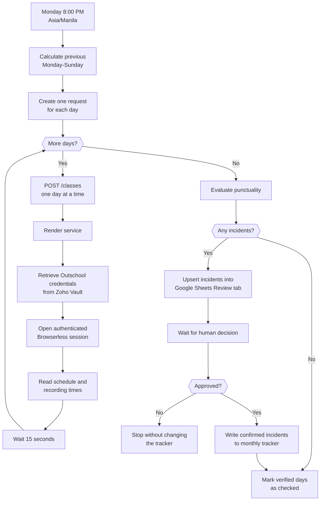

# Weekly Teacher Punctuality Automation

Automatically checks the previous week's Outschool classes against their recordings, flags punctuality incidents for human review, and updates a Google Sheets tracker only after approval.

## System flow



## Components

| Component | Responsibility |
| --- | --- |
| n8n | Scheduling, seven-day loop, retries, incident evaluation, approval gate, and Google Sheets updates |
| Render service | Authenticated API used by n8n to collect Outschool schedule and recording data |
| Browserless | Remote browser used to access authenticated Outschool pages |
| Zoho Vault | Stores and decrypts the Outschool username and password at runtime |
| Google Sheets | Review queue, approved punctuality tracker, and checked-day state |

## Analysis and approval ownership

No AI model or AI agent performs the punctuality analysis. The automation uses deterministic code and fixed thresholds:

1. The Render service reads the Outschool schedule and recording pages, parses their timestamps, and matches each recording to the closest scheduled meeting.
2. The n8n **Evaluate Punctuality** Code node compares scheduled and recorded times and classifies each result using the rules below.
3. A human reviews the generated evidence in the Google Sheet before any confirmed incident is written to the official tracker.

Human approval is completed through an n8n form:

1. **Write Review Tab** upserts each incident into the spreadsheet's **Review** tab.
2. The row includes the incident details, recording link, and an **Approval Link**.
3. The reviewer opens that link, checks the Review tab and recording evidence, and selects **Approve** or **Reject**.
4. **Wait for Human Approval** accepts one decision for the workflow run and waits for at most three days.
5. **Approved?** allows only an exact **Approve** decision to continue to the official tracker. Rejecting or not approving stops that write path.

The code identifies potential incidents; the human reviewer owns the final judgment and authorization.

## n8n node responsibilities

| Order | Node | Responsibility |
| ---: | --- | --- |
| 1 | **Monday 8 PM Manila** | Starts the workflow every Monday at 8:00 PM using the workflow's Asia/Manila timezone. It has no effect while the workflow is unpublished. |
| 2 | **Calculate Previous Week** | Calculates the previous Monday as weekStart and the previous Sunday as weekEnd. |
| 3 | **Generate Daily Requests** | Validates that the range contains exactly seven days, then creates one single-day request for each date. |
| 4 | **Process Days One at a Time** | Runs the seven requests sequentially with a batch size of one. After the final day, it releases the collected results to evaluation. |
| 5 | **Fetch Outschool Recording Data** | Calls the Render service's authenticated POST /classes endpoint for the current day. It makes up to three attempts, waits 30 seconds between attempts, and allows five minutes per attempt. |
| 6 | **Browserless Cooldown** | Waits 15 seconds after each daily response before starting the next Browserless-backed request. |
| 7 | **Evaluate Punctuality** | Deterministically combines all daily responses, ignores zero-enrollment classes, calculates late/early minutes, creates stable incident keys, labels incomplete data as **Needs Review**, and lists only fully verified days as safe to mark checked. |
| 8 | **Any Issues Found?** | Routes runs with one or more incidents to human review. Runs with no incidents skip review and proceed directly to marking verified days checked. |
| 9 | **Split Incidents** | Converts the incident array into one n8n item per incident so each can be written as a separate Review row. |
| 10 | **Write Review Tab** | Appends or updates the Google Sheet's **Review** tab using **Incident Key** as the unique match field. Writes the evidence and n8n approval-form link without duplicating an existing incident. |
| 11 | **Wait for Human Approval** | Pauses the run and serves the **Approve punctuality results** form with required **Approve** and **Reject** choices. The wait limit is three days and the node runs once for the workflow execution. |
| 12 | **Approved?** | Continues only when the submitted decision exactly equals **Approve**. The Reject/non-approve branch has no tracker-write connection. |
| 13 | **Build Tracker Rows** | Removes **Needs Review** items, groups confirmed incidents by date, and formats the teacher, class/time, details, and recording-link fields expected by each monthly sheet. |
| 14 | **Confirmed Tracker Rows?** | Sends confirmed rows to the tracker update. If every incident still needs review, it skips the incident write and continues only with eligible checked-day updates. |
| 15 | **Update Tracker** | Updates the appropriate monthly sheet by matching the day in the **Date** column and writing approved incident details plus Checked = true. |
| 16 | **List Days to Mark** | Creates one minimal sheet-name, Date, and Checked item for every day that has no unresolved recording review. |
| 17 | **Mark Days Checked** | Updates those monthly-sheet dates to Checked = true. Days with unresolved recording or timing data are excluded. |

## Punctuality rules

- **Late:** recording starts at least 1 minute after the scheduled start.
- **Early out:** recording ends at least 6 minutes before the scheduled end.
- **Needs review:** a recording is missing, still processing, or contains incomplete/invalid timing data.
- Classes with zero active learners are ignored.
- Cancellation status is not inferred from Outschool text.
- Days with unresolved recording data are not marked as checked.
- The tracker is never updated without explicit human approval.

All Outschool schedule and recording times are interpreted in `America/New_York`; workflow scheduling uses `Asia/Manila`.

## API

Base URL: `https://jenny-weekly-teacher-punctuality-check.onrender.com`

| Method | Path | Authentication | Purpose |
| --- | --- | --- | --- |
| `GET` | `/health` | None | Returns `{ "ok": true }` when the service is running |
| `GET` | `/selfcheck` | `X-API-Key` | Checks the Zoho Vault authentication/decryption chain without returning credentials |
| `POST` | `/classes` | `X-API-Key` | Returns schedule and recording data for a date range of at most seven days |
| `POST` | `/probe` | `X-API-Key` | Diagnostic snapshot for an `outschool.com` URL; output is bounded and credentials are redacted |

Example request:

```bash
curl -X POST "https://jenny-weekly-teacher-punctuality-check.onrender.com/classes" \
  -H "Content-Type: application/json" \
  -H "X-API-Key: $SERVICE_API_KEY" \
  -d '{"weekStart":"2026-10-05","weekEnd":"2026-10-05"}'
```

`weekStart` and `weekEnd` must use `YYYY-MM-DD`. The start must not be after the end, and the range must not exceed seven days.

## Configuration

Required Render environment variables:

| Variable | Purpose |
| --- | --- |
| `SERVICE_API_KEY` | Shared secret required in the n8n HTTP credential as the `X-API-Key` header |
| `BROWSERLESS_TOKEN` | Browserless API token |
| `ZOHO_CLIENT_ID` | Zoho OAuth client ID |
| `ZOHO_CLIENT_SECRET` | Zoho OAuth client secret |
| `ZOHO_REFRESH_TOKEN` | Zoho OAuth refresh token |
| `ZOHO_MASTER_PASSWORD` | Decrypts the selected Zoho Vault secret |

Optional variables:

| Variable | Default | Purpose |
| --- | --- | --- |
| `BROWSERLESS_URL` | `https://production-sfo.browserless.io/stealth` | Browserless endpoint |
| `BROWSERLESS_PROFILE` | Empty | Reusable authenticated browser profile |
| `OUTSCHOOL_LOGIN_URL` | `https://outschool.com/users/login` | Outschool login page |
| `OUTSCHOOL_TIMEZONE` | `America/New_York` | Browser timezone |
| `ZOHO_SECRET_NAME` | `Outschool` | Vault secret containing `username` and `password` fields |
| `ZOHO_ACCOUNTS_URL` | `https://accounts.zohocloud.ca` | Zoho Accounts base URL |
| `ZOHO_VAULT_URL` | `https://vault.zohocloud.ca` | Zoho Vault base URL |
| `ZOHO_REQUEST_TIMEOUT_MS` | `15000` | Zoho request timeout |
| `PORT` | `3000` | Local HTTP port; Render supplies this automatically |

The API key and all other secrets must stay in Render/n8n credentials. Do not commit them or place them directly in workflow nodes.

## Reliability and safety

- n8n sends daily requests sequentially to avoid exceeding Browserless concurrency limits.
- A 15-second cooldown separates Browserless sessions.
- The HTTP request makes up to three attempts with a 30-second delay and a 5-minute timeout per attempt.
- The service retries failed recording pages with lower concurrency.
- Every Browserless connection is closed in a `finally` block.
- API errors are bounded to 300 characters; credential values are never returned by `/selfcheck`.
- Render automatically deploys commits pushed to `main`.

The n8n workflow is intentionally inactive until it is explicitly published. Publishing enables the Monday 8:00 PM Manila schedule.

## Local development

Requires Node.js 20 or newer.

```bash
npm install
npm test
npm start
```

Run a syntax check without starting the service:

```bash
node --check server.js
```

## Test coverage

`npm test` verifies:

- Browserless endpoint and authenticated-profile construction.
- Outschool login blocker detection.
- Seven-day request validation.
- Agenda and recording parsing.
- Recording-to-class matching and missing-recording handling.
- Eastern-to-Manila conversion across daylight-saving changes.
- Zoho Vault PBKDF2, AES, RSA-1024, and RSA-4096 compatibility.

The live Google Sheets write and human-approval path should be tested only with explicit authorization because it changes production data.

## Operational checks

1. Confirm `GET /health` returns HTTP 200.
2. Run authenticated `GET /selfcheck`; every step should report `ok: true`.
3. In n8n, execute through **Evaluate Punctuality** to test collection without writing to Google Sheets.
4. Check Browserless usage for rejected sessions or exhausted units.
5. Review failed n8n executions and Render events before retrying.

Never log or paste API keys, Zoho credentials, teacher names, class names, or raw production responses into issues or documentation.
